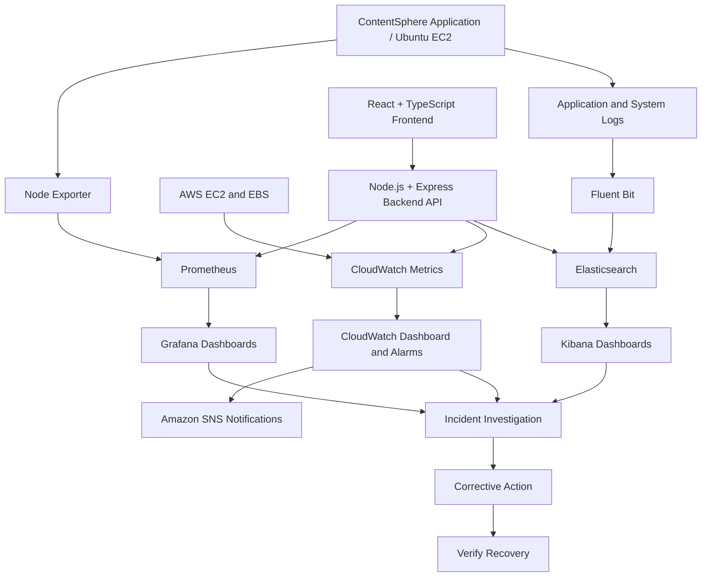

# ContentSphere Monitoring Architecture

## Component Responsibilities
- Node Exporter exposes Linux host metrics.
- Prometheus scrapes and stores time-series metrics.
- Grafana queries Prometheus and displays dashboards.
- CloudWatch collects supported AWS metrics and evaluates alarms.
- SNS delivers configured notifications.
- Fluent Bit collects and forwards logs to Elasticsearch.
- Kibana searches and visualizes indexed logs.
- The custom website retrieves data through a controlled backend API.

## Security
Restrict service access to authorized networks, use suitable authentication and encryption, apply least-privilege AWS permissions, and keep secrets out of source control.
